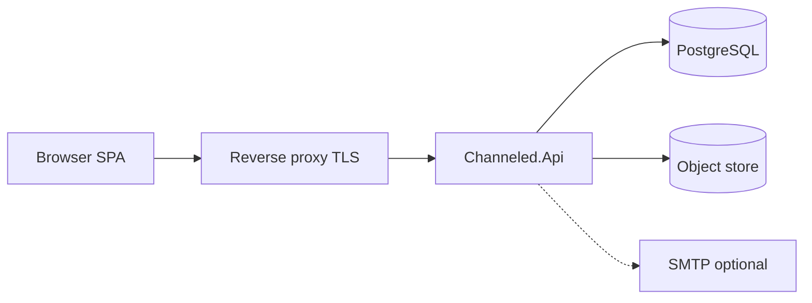

# 01 — Overview

## What Channeled is

Channeled is a **self-hosted, multi-team file-sharing platform** with optional text channels. Hierarchy:

```text
Platform
 └── Team
      └── Channel (file | text)
           └── File / Folder  or  Message
 └── Personal space (“My files”) — per user, outside any team
```

Operators run a single API process (optionally behind Caddy/nginx), PostgreSQL, and either a local filesystem object store or S3-compatible storage (MinIO, etc.). **Native install** is the primary production path; an optional **Docker Compose** stack lives at the repo root (`docker-compose.yml`, `ops/docker/`).

## Goals (as built)

| Goal | How it shows up |
|------|-----------------|
| Deny by default | Single domain `Authorizer`; unknown resources → 404 |
| Bytes never leave via store credentials | All upload/download streams through the API |
| Metadata is truth | DB rows + opaque object keys; names never in keys |
| Soft delete first | Trash retention, then purge + object_delete outbox |
| Auditable mutations | `audit_events` in the same transaction as the change |
| Personal privacy | Platform admin cannot browse personal file names/content via API |
| Native ops | systemd / Windows service samples; `pg_dump` backups |

## Explicit non-goals (v1)

Sync clients, multi-node hub clustering, E2E encryption, full-text content indexing, third-party hosted storage as a first-class product, OT/CRDT editing, chat reactions/threads as first-class, anonymous channel browse, personal-file public shares, separate download origin.

## Technology stack

| Layer | Choice |
|-------|--------|
| Runtime | .NET 10 (`net10.0`) |
| API | ASP.NET Core minimal APIs + SignalR |
| Identity | ASP.NET Core Identity (cookie auth) |
| ORM | EF Core + Npgsql |
| Database | PostgreSQL 15+ (16+ recommended) |
| Object store | `IFileStore`: filesystem (default) or S3-compatible |
| SPA | React 19 + TypeScript + Vite + TanStack Query |
| Tests | xUnit (API/Integration/Unit), Vitest, Playwright |
| CI | Fail-closed `./ci.sh` |

## Logical deployment



- SPA may be served by Vite in dev (proxy `/api` → API) or by the API’s static files in production.
- SignalR hub: `/hubs/channel` (WebSockets only).
- Health: `/health`, `/api/v1/health`; metrics: `/metrics`.

## Document map

See [README](README.md) for the full system-design index. Product intent and historical gates live in `docs/AGENTS.md` / `docs/PROGRESS.md`; durable choices in `docs/DECISIONS.md`.

**Diagrams:** [ERD, DFD, and UML](11-diagrams-erd-dfd-uml.md).
