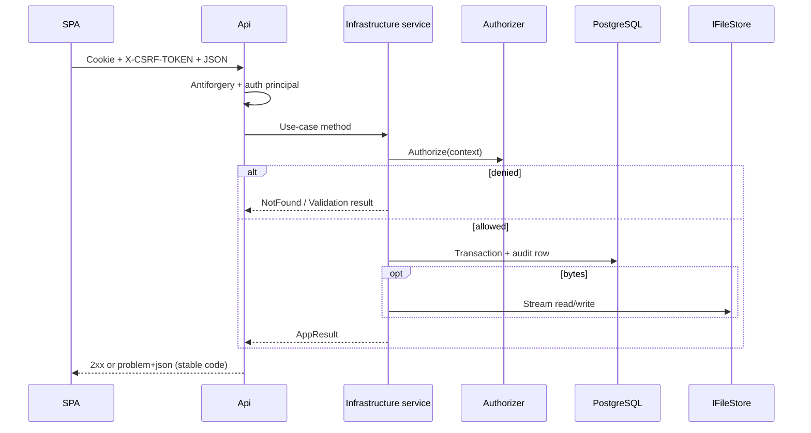

# 02 — Architecture & layering

## Solution layout

```text
Channeled.slnx
├── src/
│   ├── Channeled.Domain/          Pure domain: Authorizer, roles, rules, audit types
│   ├── Channeled.Application/     Ports, DTOs, options POCOs (no EF)
│   ├── Channeled.Infrastructure/  EF, Identity, services, jobs, stores
│   └── Channeled.Api/             HTTP, SignalR, CSRF, rate limits, CLI modes
├── tests/
│   ├── Channeled.Tests.Unit/
│   ├── Channeled.Tests.Integration/
│   └── Channeled.Tests.Api/       WebApplicationFactory against real Postgres
├── web/                           React SPA
├── ops/                           Install, backup, proxy, systemd samples
├── openapi/v1.json                Published OpenAPI (client generation)
└── docs/
```

**References:** Api → Application + Infrastructure + Domain; Infrastructure → Application + Domain; Application → Domain only.

## Layer responsibilities

| Layer | May depend on | Owns |
|-------|---------------|------|
| **Domain** | Nothing framework-specific | `Authorizer`, `MemberRole`, `AuthAction`, naming/folder rules, `AuditEventType`, `ErrorCodes` |
| **Application** | Domain | Service interfaces (`ITeamService`, `IFileService`, …), request/response records, `*Options` |
| **Infrastructure** | Application + Domain | `ApplicationDbContext`, Identity `AppUser`, service implementations, `IFileStore` adapters, job processors, hosted services |
| **Api** | All | Endpoint mapping, antiforgery, rate limiting, hub, ProblemDetails-style responses, SPA static files, operator CLI |

Authorization decisions are evaluated in Domain (`Authorizer`). Controllers/endpoints must not re-implement role matrices. The SPA may hide controls; the server remains authoritative.

## Dependency injection

Entry: `src/Channeled.Api/Program.cs` calls `AddChanneledInfrastructure(configuration)`.

`src/Channeled.Infrastructure/DependencyInjection.cs` binds options, registers:

- `AddDbContext<ApplicationDbContext>`
- Identity (`AppUser` / `AppRole`) + cookie authentication + Data Protection
- Scoped application services (teams, files, chat, admin, personal, search, …)
- Singleton `IAuthorizer`, file store, selected caches
- Hosted background services unless `DisableBackgroundJobs=true`
- Email: SMTP when `Operations:SmtpHost` is set; otherwise logging sender

Realtime coalescing notifiers are wired in `Program.cs` after infrastructure registration.

## Request path (typical mutation)



Results use `AppResult` / `AppResult<T>` with stable `ErrorCodes` (RFC 7807-shaped JSON). Hidden resources intentionally look like **404**.

## API surface (groups)

Registered from `Program.cs` (prefix `/api/v1` unless noted):

| Group | Registration | Notes |
|-------|--------------|-------|
| Auth | `MapAuthEndpoints` | Login, CSRF, sessions, password |
| Users / account | `MapUserEndpoints`, account maps | Profile, avatar, email change |
| Teams | `MapTeamEndpoints` | Teams, members, channels, join |
| Files | `MapFileEndpoints` | Channel items, uploads |
| Downloads | `MapDownloadEndpoints` | Authenticated tickets |
| Clipboard | `MapClipboardEndpoints` | Server-side copy shelf |
| Chat | `MapChatEndpoints` | Text channel messages |
| Notifications | `MapNotificationEndpoints` | Inbox |
| Public shares | `MapShareLinkEndpoints` | Anon when enabled |
| Personal | `MapPersonalEndpoints` | `/me/files` |
| Search | `MapSearchEndpoints` | Name search |
| Admin | `MapAdminEndpoints` | Platform admin only |
| Hub | `/hubs/channel` | SignalR WebSockets |

OpenAPI is published to `openapi/v1.json` for TypeScript client generation (`web` `generate:api`).

## Cross-cutting middleware (Api)

- Cookie authentication + security-stamp / session validation
- CSRF on unsafe methods (with narrow exemptions for login/register/token posts/public shares)
- Rate limiting (auth fixed-window; chat post limiter)
- Correlation / structured logging (Serilog)
- Maintenance mode → 503 (health/metrics/admin backup paths still allowed)
- Optional migrate-on-startup (`MigrateOnStartup`)

## Testing strategy

| Project | Role |
|---------|------|
| `Tests.Unit` | Authorizer matrix, pure helpers |
| `Tests.Api` | Full HTTP stack + real Postgres (`AuthApiFactory`) |
| `Tests.Integration` | Ops drills, store reconcile, benches |
| `web` Vitest | UI/unit |
| Playwright | e2e + axe (CI) |

API tests often override caps (`ChannelDelete:*`, `UserDelete:LatePhaseGraceSeconds`) via configuration in the factory.
