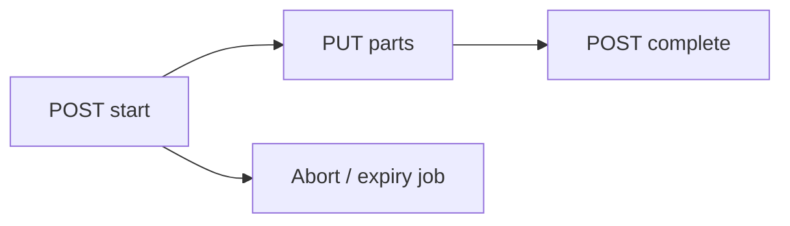

# 05 — Files, storage & quotas

## Storage abstraction

Port: `IFileStore` (Application). Implementations in Infrastructure:

| Kind | Config | Use |
|------|--------|-----|
| `FileSystem` | `FileStore:RootPath` (default `.data/object-store`) | Dev / simple deploy / unit speed |
| `S3Compatible` | Endpoint, bucket, keys | MinIO / Garage / SeaweedFS |

Object keys are opaque: `objects/<2 hex>/<2 hex>/<file-uuid>`. **Display names never appear in the store.**

Browsers never receive store credentials. All bytes stream through the API (no full-file buffering of large bodies).

## File / folder model

- A row is in **exactly one** scope: channel (`ChannelId`) **or** personal (`OwnerUserId`).
- Soft delete: `DeletedAt` + `DeletedBatchId` → `trash_batches`.
- Stars: `file_stars` (personal and channel).
- Upload sessions: `upload_sessions` + parts; abandoned sessions aborted by jobs.

Content hash: SHA-256 stored on the file row; verified at complete.

## Upload pipeline (multipart)

Endpoints under `/api/v1/uploads` (`FileEndpoints` / upload service):

1. **Start** — authorize write, name conflict, quota check, create session, open multipart in store.
2. **Parts** — stream body to store (part size default 8 MiB; Kestrel body limit sized accordingly).
3. **Complete** — verify parts, finalize, confirm SHA-256, insert file row, bump usage, audit — one DB transaction; compensate object on failure. Supports `Idempotency-Key`.
4. **Expiry** — abandoned sessions cleaned by background work.

Limits: `UploadLimits:MaxFileBytes` (default 10 GiB), `PartSizeBytes`, `UploadSessionExpiryHours`.

## Listing & locate

Shared keyset listing (`ItemListing`) for channel and personal:

- Sort: name | size | created | updated | type × asc/desc; Id tiebreak; folders-first for name/type.
- Cursor embeds sort, folder, trash flag, filter hash — mismatch → 400.
- Filters: type, uploader, `q` (literal ILIKE with escape), trash view.
- Generated `ContainerId` enables one index family for both scopes.

`GET /api/v1/items/{id}/locate` returns scope, path, and trash entry for deep links (`/open/:id`). Same browse ACL (personal = owner only).

## Trash & restore

Soft-delete path (not team/channel hard discard):

1. Insert `trash_batches` row (`DeletedAt` = retention clock).
2. Set-based stamp of the item and live descendants with the same `DeletedBatchId` (item-count cap: `ChannelDelete:MaxItemsPerTrash`).
3. Revoke nested share links where applicable.
4. **Quota still counts trash** until purge.

Restore:

- By batch for folders (entire batch revived together).
- Independent child batches stay trashed when a sibling/parent batch is restored.
- Nested restore while an ancestor folder is still trashed → `parent_trashed`.
- Name conflicts → auto-rename (`name (copy)` / `name (copy N)`).

Purge: see [08 — Jobs](08-jobs-and-background.md) (`TrashPurgeService`). Order: files then folders children-before-parents; enqueue `object_delete`; delete batch. Mid-batch crash is retriable (batch may be marked `purging`).

## Quotas

| Scope | Fields | Updated |
|-------|--------|---------|
| Team | `QuotaBytes` / `UsageBytes` | Same txn as upload/delete/purge |
| Personal | `PersonalQuotaBytes` / `PersonalUsageBytes` | Same |

Nightly (hosted) **quota reconciliation** recomputes and corrects drift. Defaults: personal 20 GiB, team 100 GiB (configurable / admin-adjustable for teams).

## Authenticated downloads

Preferred SPA path: **download tickets**

1. `POST /api/v1/downloads/tickets` (CSRF) — ACL check, returns URLs or per-item errors.
2. `GET /api/v1/downloads/{ticket}` — Data Protection payload bound to **user + session**; fresh-start window (`Downloads:TicketStartSeconds`); resume with matching strong ETag until ticket expiry; ACL re-checked every request; wrong user/session → 404.

Streaming uses shared content responder: strong ETag = SHA-256, Range/If-Range, RFC 6266 filenames, concurrent caps (`Downloads:MaxConcurrentPerUser` / global). Inline only for safe types under restrictive CSP; attachment default.

## Public share links

Kill switch: `PublicFileLinks:Enabled` (default **false**).

- Token stored as hash; HMAC tickets for anon download.
- Caps: expiry, max downloads, per-team active links, anon egress / per-IP streams.
- Claim idempotency window; mid-stream recheck.
- Personal files are **not** publicly shareable in v1.
- Admin can list/revoke; trash/team delete revoke links.

## Personal space

`PersonalService` / `/api/v1/me/files/*` — same folder/file semantics under `OwnerUserId`.

- Authorizer: owner only (no admin bypass).
- **Copy to channel** creates a new object + row (independent copy); requires write on target; audited.

## Clipboard

Server-assisted clipboard shelf for multi-item copy/move UX (`ClipboardEndpoints` / `ClipboardService`) — still subject to Authorizer and channel locks.

## Concurrency with channel writers

Destructive channel/team operations and writers coordinate via `ChannelWriteGuard`:

- Readers/writers take `FOR SHARE` (or equivalent ensure-shared) on channel rows.
- Deleters take `FOR UPDATE`.
- Multi-channel locks always ordered by ascending channel Id (deadlock avoidance).

See also [07 — Deletion lifecycles](07-deletion-lifecycles.md).
