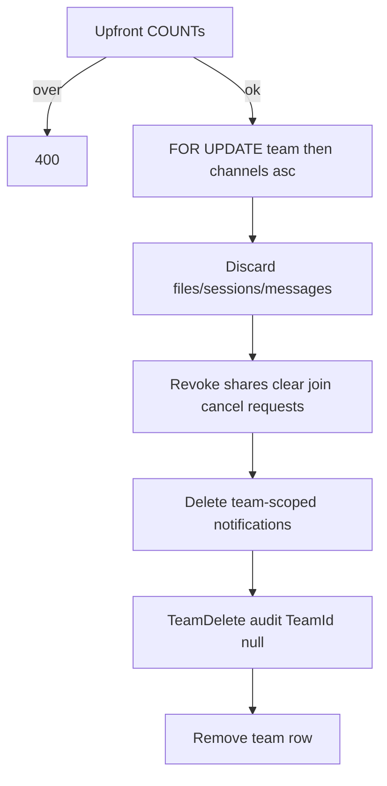

# 07 — Deletion lifecycles

Three distinct paths. Do not conflate soft-trash with hard team discard or account delete.

| Path | Trigger | Bytes | Metadata |
|------|---------|-------|----------|
| Folder/file trash | User soft-delete | Kept until purge | `trash_batches` |
| Channel discard | Channel delete (discard) | Outbox delete | Rows removed in txn |
| Team delete | Owner POST delete | Outbox delete | Team row removed |
| Admin user delete | CAS phases | Personal discarded; team files kept | User row removed at end |

Product decisions are also recorded in `docs/DECISIONS.md` (2026-10-17 entries).

---

## Team delete

**Endpoint:** `POST /api/v1/teams/{slug}/delete`  
**Body:** `{ confirmDiscard: true, password }`  
**Actor:** Owner (Authorizer `DeleteTeam`)  
**Code:** `TeamService.DeleteTeamCoreAsync`

### Caps (fail before locks)

| Cap | Config | Default |
|-----|--------|---------|
| Files per channel | `ChannelDelete:MaxFilesPerTxn` | 10_000 |
| Messages per channel | `ChannelDelete:MaxMessagesPerTxn` | 10_000 |
| Files per team | `ChannelDelete:MaxFilesPerTeamDelete` | 50_000 |
| Messages per team | `ChannelDelete:MaxMessagesPerTeamDelete` | 50_000 |

Over-cap → `team_delete_cap_exceeded` with counts. No async multi-request team delete in v1.

### One transaction

1. Set local `lock_timeout` / `statement_timeout` from config.
2. Lock team; `ChannelWriteGuard` all channels ascending Id.
3. File channels: delete file/folder rows + enqueue object keys; text: sessions/messages.
4. Revoke share links; clear join token; delete join requests; delete notifications with that `TeamId`.
5. Logo → `object_delete` outbox.
6. Insert `TeamDelete` audit **in the same txn** with `TeamId = null` and counts in `DetailsJson` (`audit_events` has no FK to teams).
7. Delete team row (members/channels cascade).

Timeout → full rollback; team intact.

After commit, join-by-link / approval cannot succeed (team gone). SPA: disclaimer + type team name + password (`TeamGeneralSettingsPage`).

---

## Admin user delete (CAS-phased)

**Not** self-service. Disable-first, resumable.

**Endpoints:**

- `GET /api/v1/admin/users/{id}/delete-preview`
- `POST /api/v1/admin/users/{id}/delete` — `{ password, teamResolutions }`
- `POST /api/v1/admin/users/{id}/enable` — cancels early phases only

**CLI:** `dotnet run … -- delete-user --actor-email … --actor-password … --email …` (same service path).

**Code:** `AdminService.UserDelete.cs`, sweep `UserDeleteSweepHostedService`.

### Phase machine

Column: `AspNetUsers.DeletePhase` ∈ `none | disabled | teams | personal | memberships`.

Each advance:

1. Clear change tracker; begin txn.
2. Lock target user (`FOR UPDATE`). If target is platform admin, lock **all** platform admins `ORDER BY Id FOR UPDATE` first (serializes mutual-delete races).
3. Re-check **enabled** platform-admin invariant.
4. Do step work if phase matches expected.
5. **CAS:** `UPDATE … SET DeletePhase = next WHERE Id = id AND DeletePhase = expected`.

| From → To | Work |
|-----------|------|
| `none` → `disabled` | Disable, lockout, revoke sessions |
| `disabled` → `teams` | Validate sole-owned team resolutions; transfers in-txn; team deletes after commit |
| `teams` → `personal` | Hard-discard personal files/folders/trash/avatar → outbox (**point of no return**) |
| `personal` → `memberships` | Strip memberships/grants; cancel join requests; delete **inbox** notifications; revoke share links created by user |
| `memberships` → gone | `UserManager.DeleteAsync` |

### Sole-owned teams

Preview lists sole-owned teams with file/message counts, `overTeamDeleteCap`, and `transferOnly` when over cap.

Resolutions: `transfer` (to enabled non-self member) or `delete` (calls internal team delete). Stale ownership or cap growth at execute → `delete_resolutions_stale` / `team_delete_cap_exceeded` + fresh preview shape.

### Cancel vs sweep

- **Cancel:** re-enable while phase is `none` / `disabled` / `teams` → clears `DeletePhase`.
- From `personal` onward: re-enable rejected (`delete_in_progress`); **sweep** finishes stuck late phases after `UserDelete:LatePhaseGraceSeconds`.

Sweep uses the same CAS advances; audit details note `completedBy: sweep`.

### Content policy after user delete

| Content | Kept? |
|---------|-------|
| Team file uploads by that user | **Yes** — chips show “Deleted user” |
| Chat message bodies | **Yes** — same chip policy |
| Personal files / avatar | **No** — discarded |
| User inbox notifications | **No** |
| Notifications where user is actor (e.g. mentions) | **Yes** |

Scrubbing retained chat/files is a **separate future admin tool** (out of scope). Documented for operators in `docs/OPERATOR_GUIDE.md`.

### UI

Admin users page: hide Delete for self; dialog loads preview; transfer-only teams disable “Delete team”; last enabled admin cannot confirm delete; password required.

---

## Folder / file trash batches

**Schema:** `trash_batches` + nullable `DeletedBatchId` on files/folders (FK RESTRICT until purged).

Trash/restore/purge details: [05 — Files](05-files-storage-and-quotas.md) and [08 — Jobs](08-jobs-and-background.md).

Invariants:

- Independent batches; restore does not revive sibling batches.
- Purge prefers children-before-parents; oldest batches first.
- Crash mid-purge must be idempotent on retry (zero orphans; reconcile clean).

---

## Channel delete (related)

Channel discard/move paths use the same `ChannelWriteGuard` and per-txn file/message caps. Team delete reuses discard helpers per channel inside the team transaction. Barrier tests live under `ChannelDeleteBarrierTests` / `TeamDeleteApiTests`.
