# 11 — Diagrams (ERD, DFD, UML)

Mermaid diagrams of the **as-built** system. Render in any Mermaid-capable viewer (GitHub, VS Code, docs site). Source of truth for relationships remains EF model + migrations (`ApplicationDbContext`).

---

## 1. Entity-relationship diagrams (ERD)

### 1.1 Core domain (teams → channels → items)

Logical ERD. Solid lines = enforced FK; dashed = logical reference without FK (or SET NULL / plain Guid).

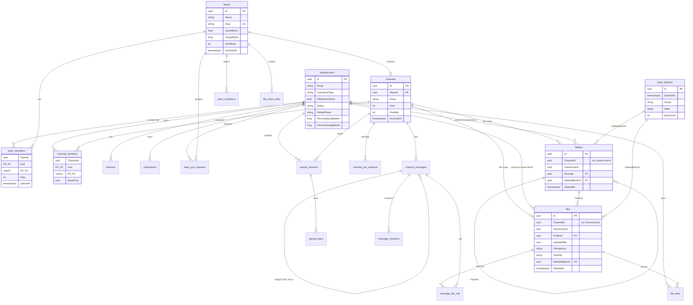

### 1.2 Chat, notifications, shares, jobs

```mermaid
erDiagram
  channels ||--o{ channel_messages : "hosts"
  channel_messages ||--o{ message_mentions : "tags"
  channel_messages ||--o{ message_file_refs : "links"
  files ||--o{ message_file_refs : "file"
  AspNetUsers ||--o{ notifications : "UserId inbox"
  teams ||--o{ notifications : "TeamId logical"
  channels ||--o{ notifications : "ChannelId logical"
  teams ||--o{ file_share_links : "TeamId"
  files ||--o{ file_share_links : "FileId SET NULL composite"
  AspNetUsers ||--o{ sessions : "UserId"
  AspNetUsers ||--o{ password_reset_tokens : "UserId"
  AspNetUsers ||--o{ pending_email_changes : "UserId"

  channel_messages {
    uuid Id PK
    uuid ChannelId FK
    uuid AuthorId
    string Body
    uuid ReplyToMessageId FK
    timestamptz DeletedAt
  }

  message_mentions {
    uuid MessageId PK_FK
    uuid UserId PK
  }

  notifications {
    uuid Id PK
    uuid UserId
    int Type
    uuid TeamId
    uuid ChannelId
    uuid MessageId
    uuid ActorId
  }

  file_share_links {
    uuid Id PK
    uuid TeamId
    uuid FileId "nullable SET NULL"
    uuid ChannelId
    string TokenHash
    int DownloadCount
    timestamptz RevokedAt
  }

  jobs {
    uuid Id PK
    string Type
    string State
    string DetailsJson
    int Attempts
    timestamptz AvailableAt
  }

  audit_events {
    uuid Id PK
    uuid ActorId "nullable no FK"
    uuid TeamId "nullable no FK"
    int EventType
    string TargetType
    string TargetId
    string DetailsJson
  }

  sessions {
    uuid Id PK
    uuid UserId FK
    timestamptz RevokedAt
  }
```

### 1.3 Cardinality & delete rules (summary)

| Parent → child | On delete | Notes |
|----------------|-----------|-------|
| Team → members, channels, join requests | CASCADE | Team delete removes graph |
| Channel → messages, channel_members | CASCADE | |
| Message → mentions, file_refs | CASCADE | |
| Message → ReplyTo | SET NULL | |
| Folder → Parent | RESTRICT | No orphan tree edges |
| File/Folder → trash_batches | RESTRICT | Clear FK before batch delete |
| Share link → file | SET NULL (file_id) | Composite FK via raw SQL |
| `audit_events.TeamId` / `ActorId` | *no FK* | Survives team/user delete |
| `files.UploadedBy` / `messages.AuthorId` | *no FK* | Chips show “Deleted user” |

Scope check: `((ChannelId IS NOT NULL AND OwnerUserId IS NULL) OR (ChannelId IS NULL AND OwnerUserId IS NOT NULL))`.

---

## 2. Data-flow diagrams (DFD)

### 2.1 Context diagram (level 0)

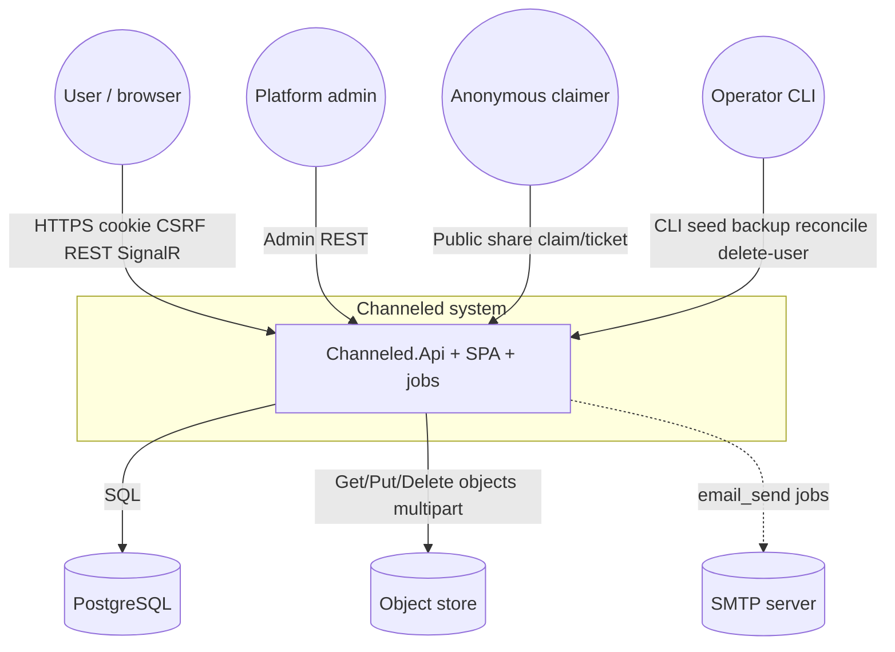

**External entities:** User, Platform admin, Anonymous share claimer, Operator.  
**Data stores (inside system boundary for L0):** PostgreSQL, object store. SMTP is external.

### 2.2 Level-1 process decomposition

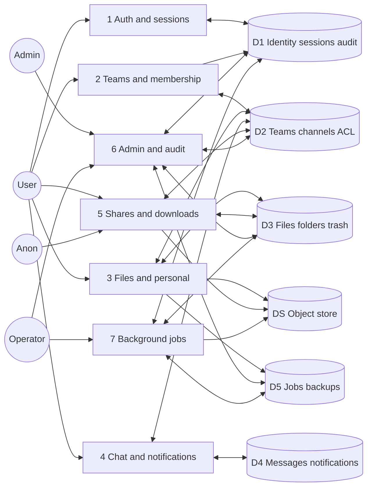

| # | Process | Primary stores |
|---|---------|----------------|
| 1 | Auth & sessions | Users, sessions, reset/email tokens, audit |
| 2 | Teams & membership | Teams, members, channels, join |
| 3 | Files & personal | Files, folders, trash, uploads, quotas |
| 4 | Chat & notifications | Messages, mentions, notifications |
| 5 | Shares & downloads | Share links, tickets, store streams |
| 6 | Admin & audit | Users, teams quotas, audit, backups |
| 7 | Background jobs | Jobs, trash purge, object_delete, mail |

### 2.3 Process 3 — upload (detailed DFD)

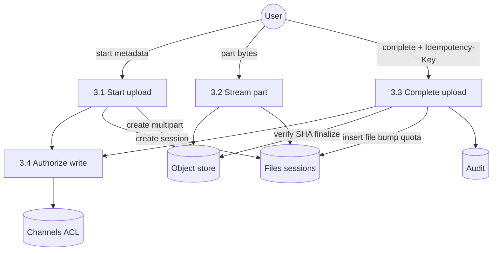

### 2.4 Process 7 — trash purge & object delete

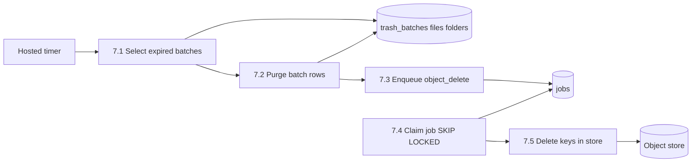

### 2.5 Process 6 — admin user delete (CAS)

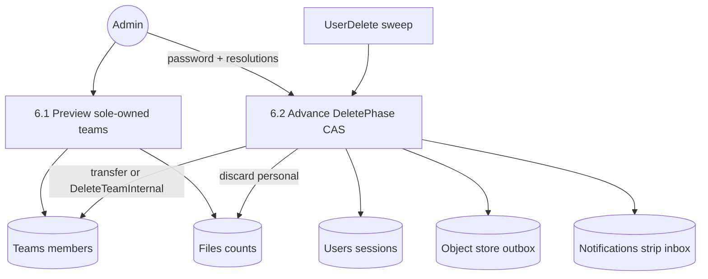

---

## 3. UML

### 3.1 Component diagram

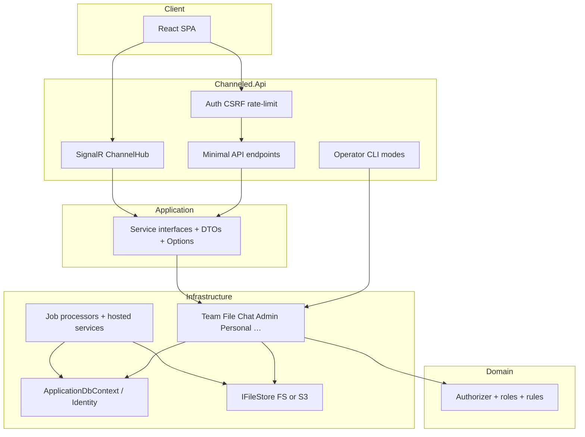

### 3.2 Package / layer diagram

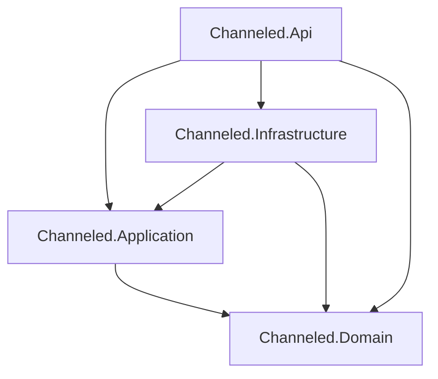

### 3.3 Class diagram — authorization & teams (simplified)

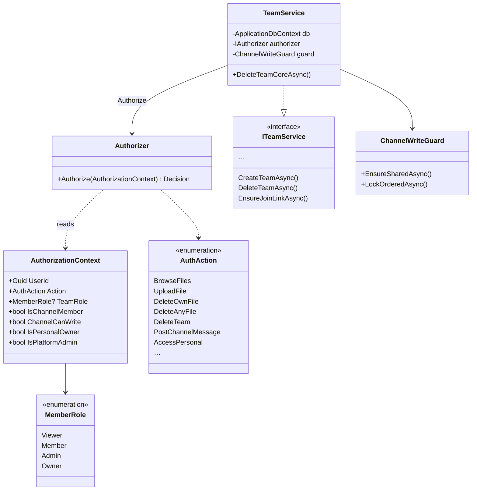

### 3.4 Class diagram — files & trash (simplified)

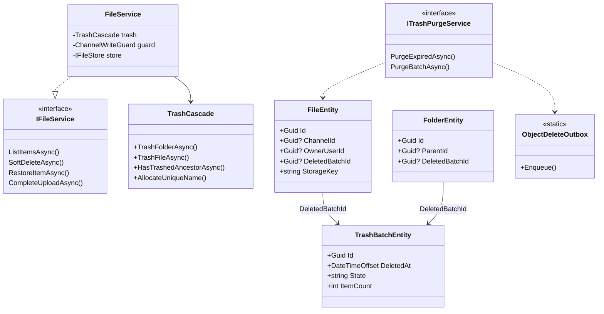

### 3.5 Sequence — authenticated download ticket

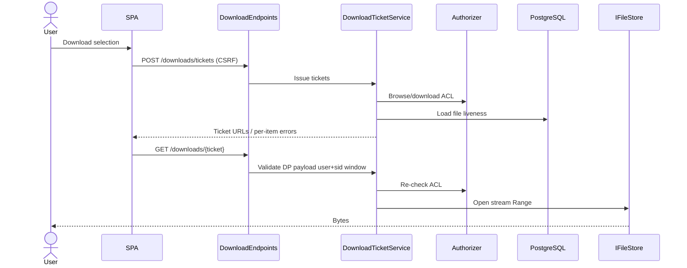

### 3.6 Sequence — multipart upload complete

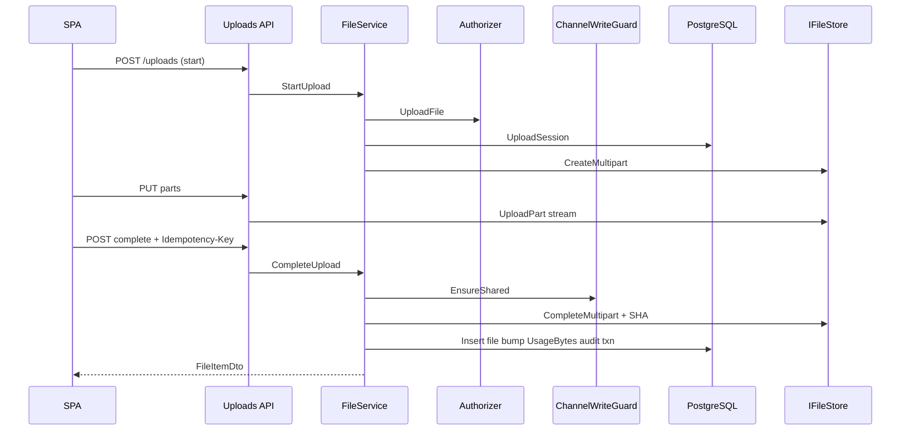

### 3.7 Sequence — team delete

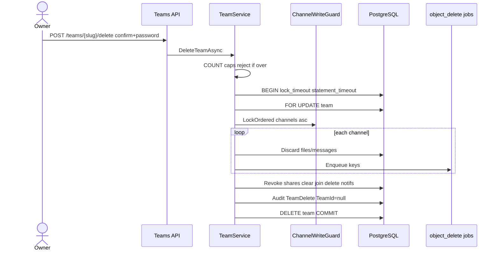

### 3.8 State machine — admin user `DeletePhase`

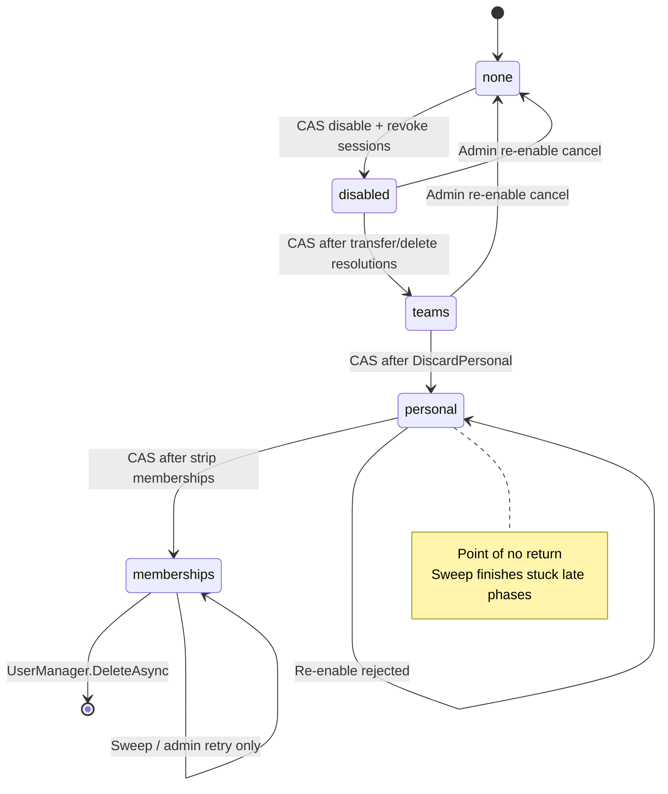

### 3.9 Deployment diagram

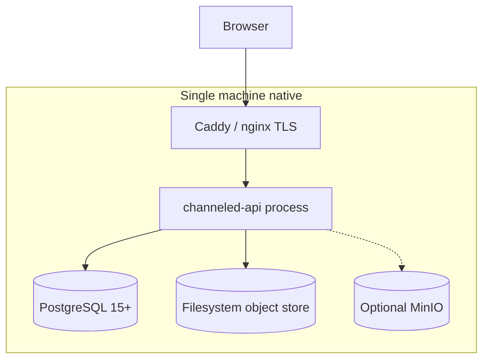

---

## 4. How to maintain these diagrams

| When you change… | Update |
|------------------|--------|
| New table / FK | §1 ERD + cardinality table |
| New external integration | §2.1 context DFD |
| New major use case | §2.2 process list + optional detailed DFD |
| New Application service / port | §3.1–3.4 UML |
| New multi-step lifecycle | Sequence + state (§3.5–3.8) |

Prefer editing this file over duplicating diagrams into feature docs; feature docs can link here (e.g. [07 — Deletion](07-deletion-lifecycles.md) ↔ §3.7–3.8).
